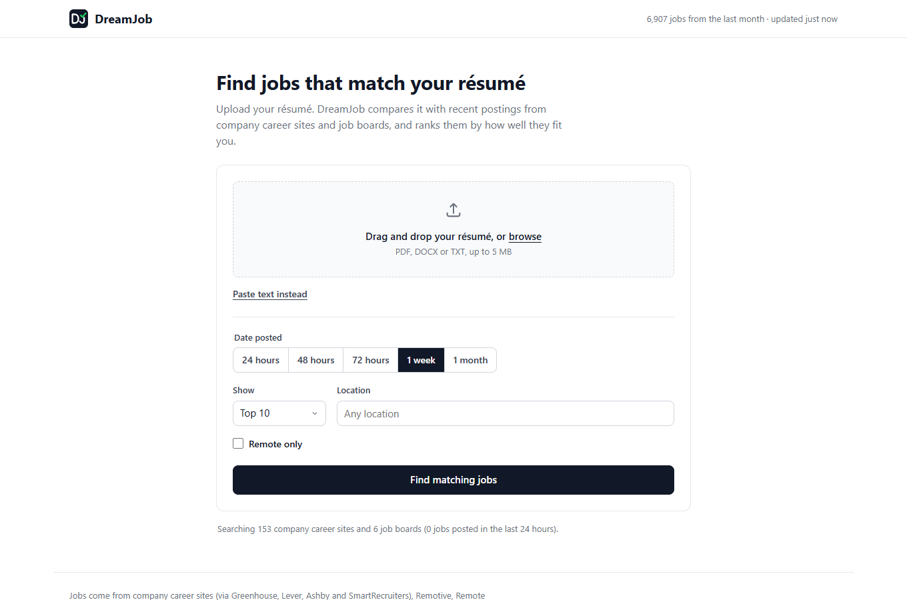
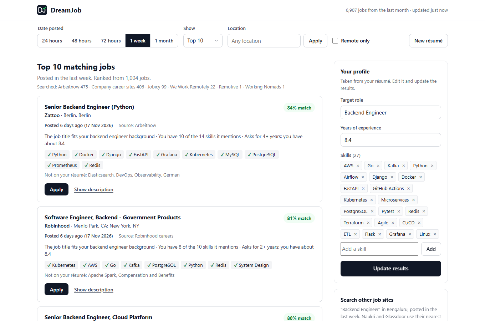

<p align="center">
  
</p>

# DreamJob

DreamJob is a free job-matching web app. Upload a résumé and it reads your skills, job titles and years of experience, then ranks recently posted jobs by how well they fit you.

- Choose how fresh the jobs must be: **last 24 hours, 48 hours, 72 hours, 1 week or 1 month**.
- Choose how many results you want: **top 3, 10, 20 or 30**.
- Optionally filter by **location** and **remote only**.
- Each result shows a match score, the reasons for it, the exact posting date, the skills you match, and the skills the job also asks for.
- Filters apply instantly; you can also correct your role, years or skills without uploading again.
- One click opens the same search on **LinkedIn, Indeed, Naukri, Glassdoor and Google Jobs** with the same date filter.

No sign-up, no paid APIs, and résumés are never stored.




---

## How it works

1. **Read the résumé.** PDF, DOCX or TXT files, or pasted text, are converted to text in memory.
2. **Build a profile.** A built-in vocabulary of about 300 skills (with aliases such as `k8s` → Kubernetes and `React.js` → React) and 270 job titles in 20 role families is matched against the text. Years of experience come from "6+ years of experience" statements and from the date ranges in your work history (education dates are ignored).
3. **Collect jobs.** A background task keeps an index of about 8,000 jobs from the last month: ~150 company career sites (refreshed hourly) and six job boards (every 30 minutes). Each search also runs a live, role-specific search; identical searches from different users share one upstream call, and results are cached.
   Only sources that report the real posting date are used, so the 24/48/72-hour, 1-week and 1-month filters are exact.
4. **Score every job (0–100)** using:
   | Signal | Weight | Meaning |
   |---|---|---|
   | Skills | 38% | Share of the job's skills you have, plus how many you match |
   | Title | 32% | How close the job title is to your titles and role family |
   | Text similarity | 17% | TF-IDF similarity between your résumé and the job text |
   | Experience | 13% | Your years against the job's required years or seniority |
5. **Rank and explain.** Jobs outside your time window or filters are dropped, duplicates removed (the employer's own posting wins), at most three jobs per company are kept, and the top N are returned with reasons.

Ranking is done in pure Python in a few milliseconds per search, with no AI API, so it costs nothing to run.

## Job sources

| Source | Coverage | Key needed |
|---|---|---|
| Company career sites | ~150 employers (Stripe, Databricks, MongoDB, Okta, Zscaler, Freshworks, Meesho, CRED, Rubrik, ServiceNow, Bosch…) through the official public job APIs of Greenhouse, Lever, Ashby and SmartRecruiters. List: `app/companies.py` | No |
| [Remotive](https://remotive.com) | Remote tech jobs (feed + live search) | No |
| [Remote OK](https://remoteok.com) | Remote jobs | No |
| [We Work Remotely](https://weworkremotely.com) | Remote jobs (RSS) | No |
| [Jobicy](https://jobicy.com) | Remote jobs | No |
| [Working Nomads](https://www.workingnomads.com) | Remote jobs | No |
| [Arbeitnow](https://www.arbeitnow.com) | Europe (mostly Germany) | No |
| [JSearch](https://rapidapi.com/letscrape-6bRBa3QguO5/api/jsearch) *(optional)* | Google for Jobs: **LinkedIn, Indeed, Glassdoor, Naukri** and company sites. Free plan ≈ 200 requests/month, so results are cached for 6 hours | Free key |
| [Adzuna](https://developer.adzuna.com) *(optional)* | On-site jobs in 19 countries incl. India, US, UK | Free key |
| [Jooble](https://jooble.org/api/about) *(optional)* | Large aggregator with India coverage | Free key |

Every result links back to the original posting and names its source, as these APIs require.

**About LinkedIn.** LinkedIn has no public jobs API and its terms forbid scraping (it also blocks cloud servers quickly), so DreamJob does not scrape it. LinkedIn jobs reach DreamJob in two legitimate ways: through JSearch (Google for Jobs) when a key is set, and through the "Search other job sites" panel, which opens LinkedIn, Indeed, Naukri, Glassdoor and Google Jobs with your role, location and date filter already applied.

**Why Himalayas is not used.** Its API reports the date a job was re-imported, not when the employer posted it; we measured gaps of up to four weeks, which made "last 24 hours" show month-old jobs.

## Tech stack

- **Backend:** Python 3.12, FastAPI, Uvicorn, httpx (async), pypdf, python-docx
- **Frontend:** plain HTML, CSS and JavaScript (no build step), served by the same app
- **Hosting:** a single Docker container (Hugging Face Spaces or Render, both free)

## Project structure

```
DreamJob/
├── app/
│   ├── main.py        # API routes, rate limiting, static files
│   ├── config.py      # settings from environment variables
│   ├── sources.py     # connectors: company career sites, job boards, optional keyed APIs
│   ├── companies.py   # the verified list of company career boards
│   ├── index.py       # job index, background refresh, live-search cache, disk snapshot
│   ├── matcher.py     # résumé reading, profile building, scoring and ranking
│   ├── nlp.py         # tokenizer, skill/title/experience extraction, TF-IDF
│   └── skills.py      # skill and job-title vocabularies
├── static/            # index.html, styles.css, app.js, logo.svg, favicon.svg, logo-512.png
├── tests/             # pytest suite (offline)
├── scripts/           # sample résumé and a 100-user load test
├── deploy/huggingface/README.md   # Space card for Hugging Face
├── .github/workflows/ # CI tests and optional keep-alive ping
├── Dockerfile
├── render.yaml
└── .env.example
```

---

## Setup

### Requirements
- Python 3.12 (3.10+ works)
- Git
- Docker (optional, for the container)

### Run locally

```bash
git clone <your-repo-url> DreamJob
cd DreamJob

python -m venv .venv
# Windows
.venv\Scripts\activate
# macOS / Linux
source .venv/bin/activate

pip install -r requirements.txt
uvicorn app.main:app --reload --port 8000
```

Open http://localhost:8000. On the very first start the job boards load within a minute and the company career sites within about five minutes (searches work meanwhile). After that the app loads a saved snapshot from `data/` instantly and only downloads new jobs.

### Run with Docker

```bash
docker build -t dreamjob .
docker run -p 7860:7860 dreamjob
```

Open http://localhost:7860.

### Configuration

Everything is optional. Set these as environment variables (see `.env.example`).

| Variable | Default | Purpose |
|---|---|---|
| `JSEARCH_API_KEY` | empty | Turns on JSearch (LinkedIn, Indeed, Glassdoor, Naukri via Google for Jobs) |
| `JSEARCH_CACHE_MINUTES` | `360` | How long JSearch results are reused (saves the small free quota) |
| `ADZUNA_APP_ID`, `ADZUNA_APP_KEY` | empty | Turns on Adzuna |
| `ADZUNA_COUNTRY` | `in` | Adzuna country code (`in`, `us`, `gb`, `de`, …) |
| `JOOBLE_API_KEY` | empty | Turns on Jooble |
| `DEFAULT_COUNTRY`, `DEFAULT_COUNTRY_NAME` | `in`, `India` | Country for keyed searches when no location is set |
| `REFRESH_MINUTES` | `30` | Job-board refresh interval |
| `BOARD_REFRESH_MINUTES` | `60` | Company career sites refresh interval |
| `BOARD_DETAIL_LIMIT` | `150` | New job descriptions fetched per company per refresh |
| `BOARD_COUNTRIES` | `in` | Extra country feeds for SmartRecruiters companies |
| `ARBEITNOW_PAGES` | `8` | Pages of 300 jobs fetched from Arbeitnow |
| `LIVE_SEARCH_TIMEOUT` | `4` | Seconds a search waits for live results |
| `LIVE_CACHE_MINUTES` | `30` | How long live results are reused |
| `MAX_UPLOAD_MB` | `5` | Largest résumé file accepted |
| `RATE_LIMIT_PER_MINUTE` | `30` | Searches per visitor per minute, per worker process |
| `TRUSTED_PROXY_HOPS` | `1` | Proxies in front of the app, used to find the visitor IP |
| `WEB_CONCURRENCY` | `2` | Worker processes (use `1` on a 512 MB host) |
| `PORT` | `7860` | Port inside the container |

### Tests

```bash
pip install -r requirements-dev.txt
pytest -q
```

### Load test

With the app running:

```bash
python scripts/load_test.py --url http://localhost:8000 --users 100
```

Measured on a laptop with 2 workers and ~7,800 indexed jobs: 100 users uploading at the same instant all succeed, with p95 latency of 2.8–3.7 seconds. A single search takes about 0.3 seconds.

## API

Interactive docs are served at `/api/docs`.

| Method | Path | Body | Returns |
|---|---|---|---|
| `POST` | `/api/analyze` | multipart: `file` *or* `text`, `window` (`24h`/`48h`/`72h`/`1w`/`1m`), `top` (3/10/20/30), `location`, `remote_only` | parsed profile and ranked jobs |
| `POST` | `/api/match` | JSON: `profile` (from `/api/analyze`, edited), `window`, `top`, `location`, `remote_only` | ranked jobs and jobs searched per source |
| `GET` | `/api/stats` | – | index size, jobs per time window, last refresh, per-source status |
| `GET` | `/api/health` | – | `{"status": "ok", "jobs": n}` |
| `GET` | `/api/skills` | – | the skill vocabulary (for autocomplete) |

## Privacy

Résumés are processed in memory for the request and then discarded. They are not written to disk, logged or sent to any third party. Only the job index is saved to disk.

## Adding companies

Open `app/companies.py` and add a line with the hiring system and the board name from the company's careers URL:

| Careers URL looks like | Add |
|---|---|
| `boards.greenhouse.io/acme` | `("greenhouse", "acme", "Acme")` |
| `jobs.lever.co/acme` | `("lever", "acme", "Acme")` |
| `jobs.ashbyhq.com/acme` | `("ashby", "acme", "Acme")` |
| `jobs.smartrecruiters.com/Acme` | `("smartrecruiters", "Acme", "Acme")` |
