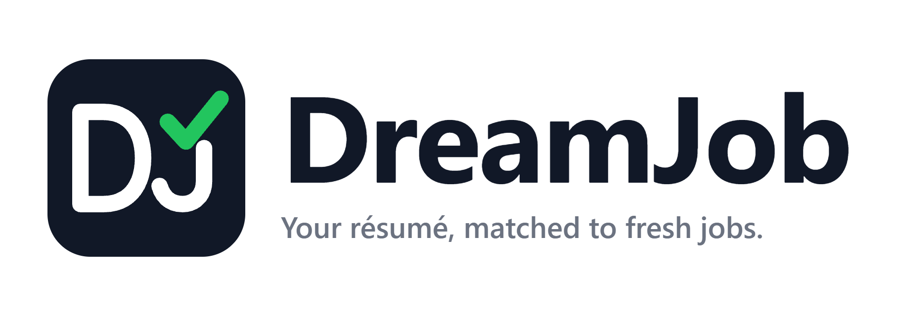

<p align="center">
  
</p>

# DreamJob

DreamJob is a job-matching web app with a companion autofill extension. Upload a résumé and it reads your skills, job titles and years of experience, then ranks recently posted jobs by how well they fit you. When you apply, the DreamJob Autofill extension fills the application form (Workday, Greenhouse, Lever and more) from your saved profile.

**Version 2.0.0**

- Choose how fresh the jobs must be: **last 24 hours, 48 hours, 72 hours, 1 week or 1 month**.
- Choose how many results you want: **top 3, 10, 20 or 30**.
- Filter by **location** and **remote only**. Filters apply instantly.
- Each result shows a match score, the full job description, a plain-language **experience verdict** ("Asks for 3–5 years; you have about 4"), the skills you match, the skills you're missing, and a breakdown of the score.
- **Unlimited skills.** Add as many as you want (comma-separated). Skills that aren't in DreamJob's built-in list are matched against each job's full description.
- One click opens the same search on **LinkedIn, Indeed, Naukri, Glassdoor, Google Jobs and Wellfound**.
- **Autofill extension** for Chrome and Edge: one click fills names, contact details, address, links, work history, education, common questions and your résumé file.
- Optional **DreamJob Pro** through **Razorpay** (UPI, cards, net banking, wallets). With no payment keys set, everything is free.

No sign-up, no paid APIs, and résumés are never stored.


---

## How it works

1. **Read the résumé.** PDF, DOCX or TXT files, or pasted text, are converted to text in memory.
2. **Build a profile.** A built-in vocabulary of about 300 skills (with aliases such as `k8s` → Kubernetes) and 270 job titles in 20 role families is matched against the text. Years of experience come from "6+ years of experience" statements and from the date ranges in your work history (education dates are ignored).
3. **Collect jobs.** A background task keeps an index of the last month's jobs from about 186 company career sites (refreshed hourly) and seven job boards (every 30 minutes, Hacker News every 2 hours). Each search also runs a live, role-specific search. Identical searches from different users share one upstream call, and results are cached. Only sources that report the real posting date are used, so the date filters are exact.
4. **Score every job (0–100):**
   | Signal | Weight | Meaning |
   |---|---|---|
   | Skills | 36% | Share of the job's skills you have, plus how many you match (including your custom skills) |
   | Title | 30% | How close the job title is to your titles and role family |
   | Text similarity | 14% | TF-IDF similarity between your résumé and the job text |
   | Experience | 20% | Your years against the job's required range ("3–5 years", "4+ years", "3 Jahre") or its seniority from the title (Intern, I, II, Senior, Staff…) or description ("entry level", "new grad") |
5. **Match experience.** With **Match my experience level** on (the default), roles that need clearly more experience than you have (for example 5+ years when you have 3, or Senior/Staff roles for a fresher) and roles clearly too junior for you are hidden; the results say how many. Jobs that state nothing stay but rank lower. Jobs that list four or more specific skills, none of them yours, with a different title, are dropped.
6. **Rank and explain.** Newer postings win between similar scores. Jobs outside your time window or filters are dropped, duplicates removed (the employer's own posting wins), at most three jobs per company are kept, and the top N are returned with reasons.

Ranking runs in pure Python in a few milliseconds per search, with no AI API, so it costs nothing to run.

## Job sources

| Source | Coverage | Key needed |
|---|---|---|
| Company career sites | ~186 employers (Stripe, Databricks, Snowflake, MongoDB, OpenAI, Anthropic, Freshworks, Meesho, CRED, Paytm, ServiceNow, Bosch…) through the official public job APIs of Greenhouse, Lever, Ashby and SmartRecruiters, with full descriptions. List: `app/companies.py` | No |
| [Hacker News "Who is hiring?"](https://news.ycombinator.com/submitted?id=whoishiring) | Monthly thread of startup jobs, read through the public Algolia API | No |
| [Remotive](https://remotive.com) | Remote tech jobs (feed + live search) | No |
| [Remote OK](https://remoteok.com) | Remote jobs | No |
| [We Work Remotely](https://weworkremotely.com) | Remote jobs (RSS) | No |
| [Jobicy](https://jobicy.com) | Remote jobs | No |
| [Working Nomads](https://www.workingnomads.com) | Remote jobs | No |
| [Arbeitnow](https://www.arbeitnow.com) | Europe (mostly Germany) | No |
| [JSearch](https://rapidapi.com/letscrape-6bRBa3QguO5/api/jsearch) *(optional)* | Google for Jobs: **LinkedIn, Indeed, Glassdoor, Naukri** and company sites. Free plan ≈ 200 requests/month, cached for 6 hours | Free key |
| [Adzuna](https://developer.adzuna.com) *(optional)* | On-site jobs in 19 countries incl. India, US, UK | Free key |
| [Jooble](https://jooble.org/api/about) *(optional)* | Large aggregator with India coverage | Free key |
| [Careerjet](https://www.careerjet.com/partners/api) *(optional)* | Aggregates Indian and global job sites | Free publisher key |

**Deep search.** When any portal key is set, every résumé is searched live on each connected portal up to three times (the main job titles, then the strongest skills), filtered to your experience band where the portal supports it (JSearch), and DreamJob waits up to 20 seconds for all of them. Identical searches from different people share one request and are cached, which protects free quotas.

**Getting LinkedIn, Naukri, Monster (foundit) and Indeed jobs.** These sites have no public job API and their terms forbid scraping, so DreamJob reads them through licensed aggregators instead. A free JSearch key (rapidapi.com → JSearch → Basic plan) brings in their listings through Google for Jobs. Jooble, Adzuna and Careerjet keys add more Indian listings. Add the keys as secrets and restart: nothing else changes.

Every result links back to the original posting and names its source.

**Not used, on purpose.** LinkedIn and Naukri have no public jobs API and their terms forbid scraping, so DreamJob links to them instead (and reaches LinkedIn listings through JSearch when a key is set). Workday career sites rate-limit automated readers heavily and don't sort by date, so DreamJob helps with Workday through the autofill extension instead. The Muse blocks automated access. Himalayas reports re-import dates, not real posting dates.

## Autofill extension

The `extension/` folder is a Manifest V3 extension for Chrome and Edge. The web app serves it as a zip at `/download/dreamjob-autofill.zip`, with install steps at `/autofill`.

- Save your profile once: personal details, address, links, work history, education, salary and notice period, yes/no answers (work authorization, sponsorship, relocation), your own answers to recurring questions, and your résumé file. **Import details from résumé** fills most of it from your DreamJob server.
- On Workday, Greenhouse, Lever, Ashby, SmartRecruiters, Workable, iCIMS, SuccessFactors, Taleo, Recruitee, Breezy, Personio, BambooHR, Jobvite and Oracle sites, a **Fill with DreamJob** button appears. On any other site, use the toolbar popup or **Alt+Shift+F**.
- It handles React-style inputs, Workday's custom dropdowns, month/year date boxes, radio questions, repeated work and education blocks (adding missing ones on Workday), and attaching your résumé.
- It only fills empty fields, outlines what it filled, and **never clicks Submit, Next or consent boxes**.
- All data stays in the browser's extension storage.

## Sign-in (email and Google)

Visitors can sign in with a **one-time email link** or **Continue with Google**. Both need no database and store no passwords:

- **Email:** DreamJob emails a link that works once and expires in 15 minutes. Opening it shows a confirm button, so email scanners that pre-open links can't use it up.
- **Google:** OAuth 2.0 authorization-code flow with PKCE and a state value bound to a short-lived cookie. Only verified Google emails are accepted.
- Either way the browser gets a signed, `HttpOnly`, `SameSite=Lax` session cookie (Secure on HTTPS) valid for 30 days.
- Sign-in is optional by default. `AUTH_REQUIRED=1` requires it before searching.
- Signed-in users have their email filled in at checkout and when restoring Pro.
- Emailed links always use `SITE_URL`, never the request's Host header, so links can't be pointed at another site.

Setup:
1. **Google:** in the Google Cloud Console, create an OAuth consent screen (External, scopes `openid`, `email`, `profile`) and an **OAuth client ID** of type *Web application* with the redirect URI `https://<your-site>/auth/google/callback` (and `http://localhost:8000/auth/google/callback` for local testing). Set `GOOGLE_CLIENT_ID` and `GOOGLE_CLIENT_SECRET`.
2. **Email:** any SMTP service works. Gmail: turn on 2-Step Verification, create an **App Password**, then set `SMTP_HOST=smtp.gmail.com`, `SMTP_PORT=587`, `SMTP_USER=you@gmail.com`, `SMTP_PASSWORD=<app password>`, `SMTP_FROM=DreamJob <you@gmail.com>`. Brevo's free SMTP plan also works.
3. Set `SITE_URL` to the public address and `AUTH_SECRET` to a long random string.

## DreamJob Pro (Razorpay)

Payments are off until you set Razorpay keys. When they're on, **Top 20 and Top 30** need a Pro pass (₹99 for 30 days by default, one-time, no auto-renewal). Everything else stays free.

- The server creates the Razorpay order, so the amount can't be changed in the browser.
- After checkout, the server verifies the payment signature with the key secret, confirms the payment with Razorpay's API (right order, right amount, captured), captures it if needed, and issues a signed pass. No database is needed.
- **Restore access** re-issues the pass on any device from the payment ID and the email used at checkout.
- Webhooks are verified with the webhook secret. A refund revokes the pass.
- Terms, Privacy, Refund and Contact pages are built in (`/terms`, `/privacy`, `/refunds`, `/contact`, `/pricing`) and filled from your business settings.

Step-by-step Razorpay account setup, test cards and UPI IDs, the webhook, and going live are in the PDF guide.

## Tech stack

- **Backend:** Python 3.12, FastAPI, Uvicorn, httpx (async), pypdf, python-docx
- **Frontend:** plain HTML, CSS and JavaScript (no build step), served by the same app
- **Extension:** Manifest V3, plain JavaScript
- **Payments:** Razorpay Standard Checkout and Orders API (called over HTTPS with httpx, no SDK)
- **Hosting:** a single Docker container (Hugging Face Spaces or Render, both free)

## Project structure

```
DreamJob/
├── app/
│   ├── main.py        # API routes, rate limiting, security headers, pages, extension download
│   ├── payments.py    # Razorpay orders, signature checks, Pro passes, restore, webhooks
│   ├── config.py      # settings from environment variables
│   ├── sources.py     # connectors: company career sites, job boards, Hacker News, keyed APIs
│   ├── companies.py   # the verified list of company career boards
│   ├── index.py       # job index, background refresh, live-search cache, disk snapshot
│   ├── matcher.py     # résumé reading, profile building, scoring, experience verdicts
│   ├── nlp.py         # tokenizer, skill/title/experience/contact extraction, TF-IDF
│   ├── skills.py      # skill and job-title vocabularies
│   └── pages/         # pricing, terms, privacy, refunds, contact, autofill (filled from settings)
├── static/            # index.html, styles.css, app.js, logos
├── extension/         # DreamJob Autofill (Chrome/Edge, Manifest V3)
├── tests/             # pytest suite (offline, 46 tests)
├── scripts/           # sample résumé and a 100-user load test
├── docs/              # PDF guide generator and screenshots
├── deploy/huggingface/README.md
├── .github/workflows/ # CI tests and optional keep-alive ping
├── Dockerfile
├── render.yaml
└── .env.example
```

---

## Setup

### Requirements
- Python 3.12 (3.10+ works)
- Git
- Docker (optional)
- Chrome or Edge (for the extension)

### Run locally

```bash
git clone https://github.com/Software-Cookie/DreamJob.git
cd DreamJob

python -m venv .venv
# Windows
.venv\Scripts\activate
# macOS / Linux
source .venv/bin/activate

pip install -r requirements.txt
uvicorn app.main:app --reload --port 8000
```

Open http://localhost:8000. On the first start, the job boards load within a minute and the company career sites within about five minutes (searches work meanwhile). After that, the app loads a saved snapshot from `data/` instantly.

### Run with Docker

```bash
docker build -t dreamjob .
docker run -p 7860:7860 --env-file .env dreamjob
```

Open http://localhost:7860. Leave out `--env-file .env` if you have no settings.

### Install the extension (development)

1. Open `chrome://extensions` (or `edge://extensions`) and turn on **Developer mode**.
2. Click **Load unpacked** and choose the `extension` folder.
3. On the profile page, choose your résumé, enter `http://localhost:8000` as the server and click **Import details from résumé**. Check the details, then **Save profile**.

### Turn on payments (test mode)

1. Create a free Razorpay account and switch the dashboard to **Test Mode**.
2. Generate test API keys (**Account & Settings → API Keys**).
3. Set the variables and restart:
   ```bash
   RAZORPAY_KEY_ID=rzp_test_xxxxxxxx
   RAZORPAY_KEY_SECRET=xxxxxxxxxxxxxxxx
   CONTACT_EMAIL=you@example.com
   ```
4. Choose **Top 20** in the app, then pay with a test card or the test UPI ID `success@razorpay`.

Never put real keys in the repository. On a host, use its **Secrets** page.

### Configuration

Everything is optional. See `.env.example` for the full list.

| Variable | Default | Purpose |
|---|---|---|
| `RAZORPAY_KEY_ID`, `RAZORPAY_KEY_SECRET` | empty | Turn on payments (both needed) |
| `RAZORPAY_WEBHOOK_SECRET` | empty | Verifies Razorpay webhooks (refunds revoke passes) |
| `PASS_SECRET` | derived | Signs Pro passes |
| `PRO_PRICE_INR`, `PRO_DAYS`, `PRO_TOPS` | `99`, `30`, `20,30` | Price, length and what Pro unlocks |
| `AUTH_SECRET`, `AUTH_REQUIRED` | random file, off | Signs sessions and links; make sign-in mandatory |
| `GOOGLE_CLIENT_ID`, `GOOGLE_CLIENT_SECRET` | empty | Turn on "Continue with Google" |
| `SMTP_HOST`, `SMTP_PORT`, `SMTP_USER`, `SMTP_PASSWORD`, `SMTP_FROM` | empty, `587` | Turn on email sign-in links |
| `BUSINESS_NAME`, `CONTACT_EMAIL`, `BUSINESS_ADDRESS` | `DreamJob`, empty, empty | Shown on the policy and contact pages |
| `JSEARCH_API_KEY` | empty | Turns on JSearch (LinkedIn, Indeed, Glassdoor, Naukri via Google for Jobs) |
| `ADZUNA_APP_ID`, `ADZUNA_APP_KEY`, `ADZUNA_COUNTRY` | empty, empty, `in` | Turns on Adzuna |
| `JOOBLE_API_KEY` | empty | Turns on Jooble |
| `CAREERJET_API_KEY`, `CAREERJET_LOCALE` | empty, `en_IN` | Turns on Careerjet |
| `DEEP_QUERIES`, `DEEP_SEARCH_TIMEOUT` | `3`, `20` | Live searches per résumé per portal, and seconds to wait for them |
| `DEFAULT_COUNTRY`, `DEFAULT_COUNTRY_NAME` | `in`, `India` | Country for keyed searches when no location is set |
| `REFRESH_MINUTES`, `BOARD_REFRESH_MINUTES` | `30`, `60` | Refresh intervals |
| `BOARD_DETAIL_LIMIT` | `150` | New job descriptions fetched per company per refresh |
| `MAX_UPLOAD_MB` | `5` | Largest résumé file accepted |
| `RATE_LIMIT_PER_MINUTE` | `30` | Searches per visitor per minute, per worker |
| `WEB_CONCURRENCY` | `2` | Worker processes (use `1` on a 512 MB host) |

### Tests

```bash
pip install -r requirements-dev.txt
pytest -q
```

### Load test

```bash
python scripts/load_test.py --url http://localhost:8000 --users 100
```

## API

Interactive docs are served at `/api/docs`.

| Method | Path | Body | Returns |
|---|---|---|---|
| `POST` | `/api/analyze` | multipart: `file` or `text`, `window`, `top`, `location`, `remote_only` | parsed profile and ranked jobs |
| `POST` | `/api/match` | JSON: `profile`, `window`, `top`, `location`, `remote_only` | ranked jobs |
| `POST` | `/api/profile/extract` | multipart: `file` or `text` | contact details, work history, education, skills (for the extension) |
| `GET` | `/api/auth/me` | – | the signed-in user (or null) and which sign-in methods are on |
| `POST` | `/api/auth/email/start` | JSON: `email`, `next` | emails a one-time sign-in link |
| `GET` | `/auth/google/start` | query: `next` | redirects to Google |
| `POST` | `/api/auth/logout` | – | clears the session |
| `POST` | `/api/pay/order` | – | a Razorpay order for DreamJob Pro |
| `POST` | `/api/pay/verify` | JSON: `razorpay_order_id`, `razorpay_payment_id`, `razorpay_signature` | a signed Pro pass |
| `POST` | `/api/pay/restore` | JSON: `payment_id`, `email` | the Pro pass again |
| `POST` | `/api/pay/status` | header `X-DreamJob-Pass` | whether the pass is active |
| `POST` | `/api/pay/webhook` | Razorpay webhook | `{"ok": true}` |
| `GET` | `/api/config` | – | version and public payment settings (never secrets) |
| `GET` | `/api/stats`, `/api/health`, `/api/skills` | – | index status, health, skill list |

Top 20 and Top 30 need the `X-DreamJob-Pass` header when payments are on; without it the API answers `402`.

## Privacy and security

- Résumés are processed in memory and discarded. They are not written to disk, logged or sent to third parties.
- Card and UPI details are entered on Razorpay's checkout only. Secrets are read from environment variables, never sent to the browser and never logged.
- Responses carry a Content Security Policy, `X-Frame-Options: DENY`, HSTS and `nosniff`. Searches, payments and imports are rate-limited.
- The extension stores your profile only in the browser and only reads a page when you ask it to fill one.

## Adding companies

Open `app/companies.py` and add a line with the hiring system and the board name from the company's careers URL:

| Careers URL looks like | Add |
|---|---|
| `boards.greenhouse.io/acme` | `("greenhouse", "acme", "Acme")` |
| `jobs.lever.co/acme` | `("lever", "acme", "Acme")` |
| `jobs.ashbyhq.com/acme` | `("ashby", "acme", "Acme")` |
| `jobs.smartrecruiters.com/Acme` | `("smartrecruiters", "Acme", "Acme")` |
